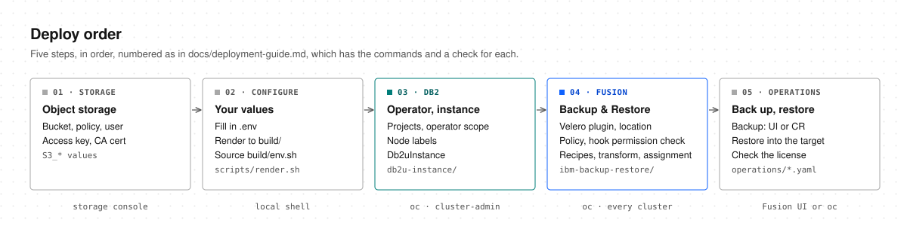
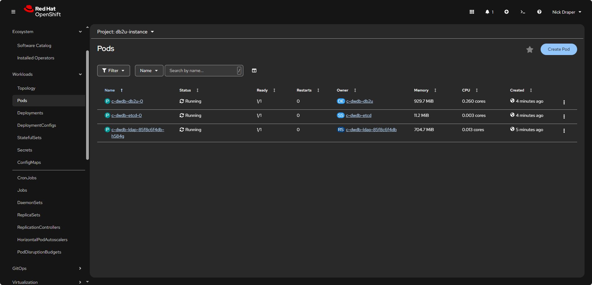
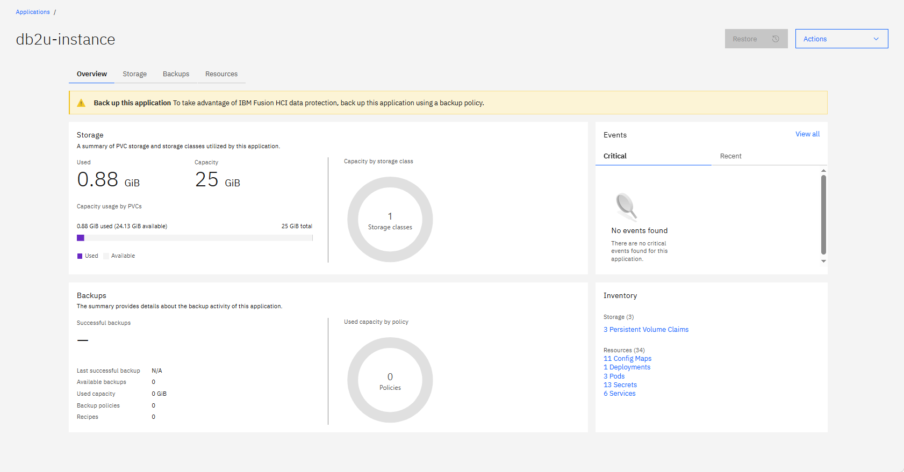
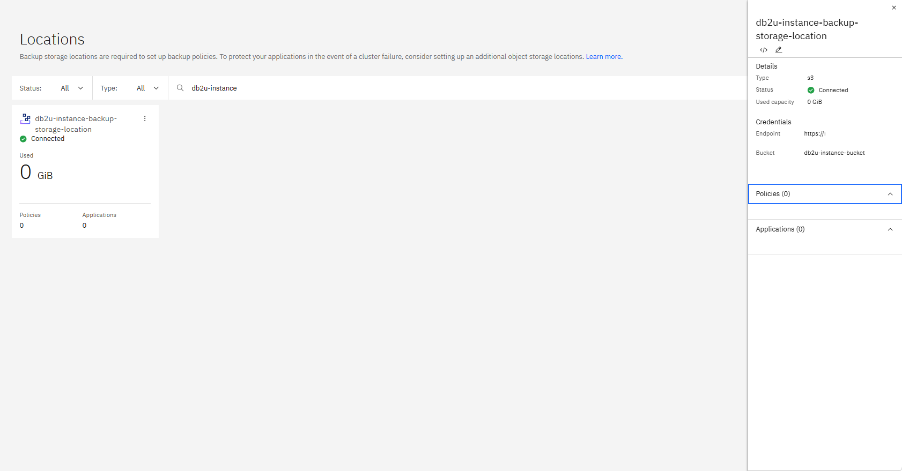
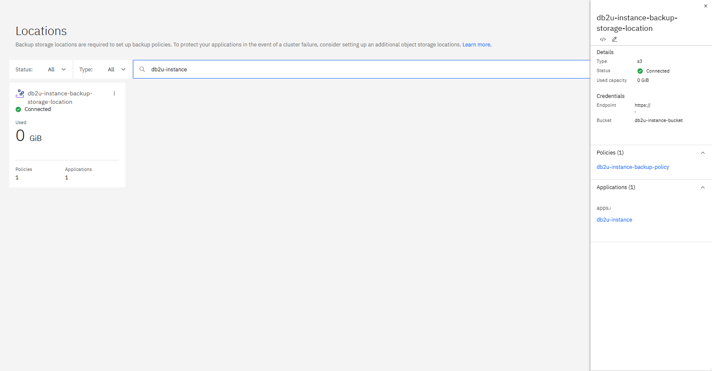
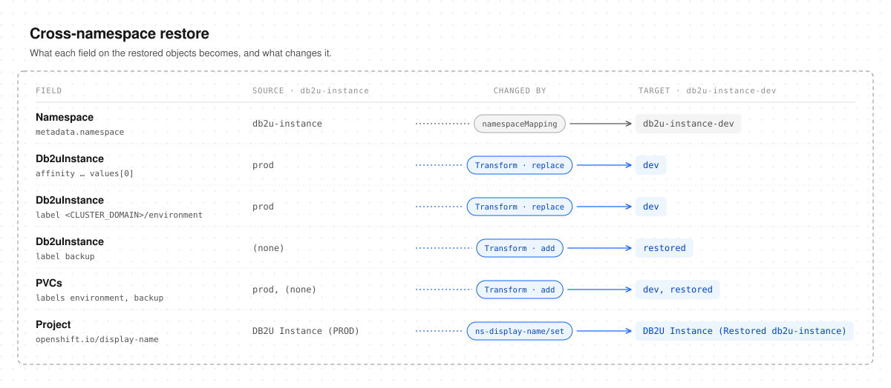
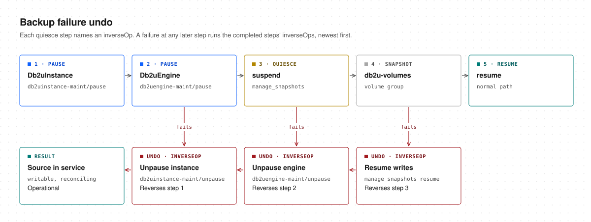

# Deployment guide

This guide deploys the Db2uInstance recipe on a worked example, backs up the instance, and restores it into another namespace. Every step is a set of `oc` commands you run yourself, followed by a check. Don't start the next step until the check passes. Every command that changes the cluster comes after a dry run of itself: run the dry run, read its output, and run the real command only if the output is what you expect ([Dry runs](#dry-runs)). Nothing here is scripted against the cluster: `render.sh` fills the manifests with your values and writes them to local files, and the repository's other scripts only check files or read from the cluster.

## Prerequisites

- OpenShift Container Platform (tested on 4.20.28)
- IBM Fusion Backup & Restore (tested on Fusion HCI 2.12.2)
- The Db2u operator (tested on Db2 12.1.4)
- S3-compatible object storage
- On your workstation: `oc`, logged in as cluster-admin; `jq` (§4.1); `bash` for `scripts/render.sh`; and an S3 client such as MinIO's `mc` to set up the bucket (§1)

## What you deploy

The worked example backs up the `Db2uInstance` `dwdb` in **`db2u-instance`** and restores it into **`db2u-instance-dev`**.

<picture>
  <source media="(prefers-color-scheme: dark)" srcset="images/how-it-works-recipes-architecture-dark.svg">
  
</picture>

Two namespaces are not in the figure: `db2u-instance-dev`, the empty project you restore into, and `ibm-backup-restore`, where Fusion runs its DataProtectionApplication (the Velero plugin) and the `transaction-manager` that runs the recipe's annotation hooks. The backup policy, `db2u-instance-backup-policy`, writes to `db2u-instance-backup-storage-location`.

The steps, in order:

<picture>
  <source media="(prefers-color-scheme: dark)" srcset="images/deployment-guide-overview-deploy-order-dark.svg">
  
</picture>

| Step | Section | Files |
| --- | --- | --- |
| 1. Object storage: bucket, policy, user, access key | [§1](#1-object-storage), [object-storage-setup.md](object-storage-setup.md) | none (done on the storage side) |
| 2. Set your values, render the manifests, check access | [§2](#2-configure-your-environment) | [`.env.example`](../.env.example), [`scripts/render.sh`](../scripts/render.sh) |
| 3. Projects, Db2 operator scope, instance | [§3](#3-projects-db2-operator-and-instance) | [`templates/db2u-instance/`](../templates/db2u-instance/) |
| 4. Fusion: Velero plugin, storage location, policy, hook permission check, recipes, transform, assignment | [§4](#4-ibm-fusion-backup--restore) | [`templates/ibm-backup-restore/`](../templates/ibm-backup-restore/) |
| 5. Back up and restore | [operations.md](operations.md) | [`templates/ibm-backup-restore/operations/`](../templates/ibm-backup-restore/operations/) |

Before the first backup, every line of [Ready to back up?](#ready-to-back-up) must pass.

## Dry runs

A dry run sends the command to the cluster, which validates it, runs admission, and reports what it would do, then saves nothing:

| Command | Dry run | Output |
| --- | --- | --- |
| `oc apply -f <file>` | `oc apply --dry-run=server -f <file>` | Each object, then `created`, `configured` or `unchanged`, and `(server dry run)` |
| `oc patch …` | the same command with `--dry-run=server -o jsonpath=…` | The patched field as it would be saved |
| `oc label …` | the same command with `--dry-run=server` | Each object, then `labeled` and `(server dry run)` |

To see field by field what an `oc apply` would change in an object that already exists, run `oc diff -f <file>`. It prints nothing when the object already matches.

A dry run of an object in a namespace that doesn't exist yet fails with `NotFound`. That's why each project is applied before the dry run of what goes in it. If a dry run fails because a webhook doesn't support dry run, use `--dry-run=client -o yaml` instead: it checks only that the file is valid YAML, and prints the object as it would be sent.

---

## 1. Object storage

Create the bucket, policy, user and access key, and save the endpoint's CA certificate: [object-storage-setup.md](object-storage-setup.md). If the endpoint has a private certificate, save it in the repository root as `object-storage-cert-secret.crt` ([§5 of that page](object-storage-setup.md#5-save-the-ca-certificate)), next to the `.env` you create in §2.

Capture these details. They go in `.env` in [§2](#2-configure-your-environment):

| `.env` key | Value | Example |
| --- | --- | --- |
| `S3_BUCKET_NAME` | Bucket name | `db2u-instance-bucket` |
| `S3_ENDPOINT` | Endpoint URL | `https://my.object.storage:9000` |
| `S3_CA_CERT` | The endpoint's CA certificate, saved as a PEM file in the repository root. Leave it empty if the endpoint has a publicly trusted certificate | `object-storage-cert-secret.crt` |
| `S3_REGION` | Region; MinIO ignores it, but the S3 client needs one | `us-west-2` |
| `S3_ACCESS_KEY_ID` | Access key | `<access-key-id>` |
| `S3_ACCESS_KEY` | Secret key | `<access-key>` |

`*.crt` and `*.pem` files are git-ignored, and the pre-commit hook blocks them, so the certificate stays out of the repository.

**Check:** you can list the bucket with the new key, for example `mc ls backup/db2u-instance-bucket` after `mc alias set` with the user's key.

---

## 2. Configure your environment

### Set your values

Your values go in one file, `.env`. The manifests in the repository are templates with `${NAME}` placeholders, and [`scripts/render.sh`](../scripts/render.sh) fills them from `.env` into `build/`. Every `oc apply` below uses the copy in `build/`.

Where the files go, all in the repository root:

| File | Who makes it | Holds |
| --- | --- | --- |
| `.env` | You, from `.env.example` (below) | Your values |
| `object-storage-cert-secret.crt` | You, in [§1](#1-object-storage) | The endpoint's CA certificate; only if it has a private one. Its path is `S3_CA_CERT` |
| `build/` | `render.sh` | Don't create it, and don't keep anything in it: every render deletes it and writes it again |

From the repository root:

```bash
cp .env.example .env
```

Fill in every key; only `S3_CA_CERT` may be empty. Each is described in [`.env.example`](../.env.example):

| `.env` key | Fills | Example |
| --- | --- | --- |
| `CLUSTER_DOMAIN` | Your cluster's domain: the prefix of the environment label key `<CLUSTER_DOMAIN>/environment` on the instance, its nodes and the restored objects, and the cluster part of backup names | `my.cluster` |
| `FUSION_NS` | Namespace of the storage location, policy, recipes, transform, assignment, backups and restores | `ibm-spectrum-fusion-ns` |
| `OP_NS` | Db2u operator namespace: OperatorGroup and `namespace-scope` ConfigMap | `db2-operator` |
| `SOURCE_NS` | Instance namespace and Fusion Application; `namespaceMapping` source | `db2u-instance` |
| `TARGET_NS` | Restore target project; `namespaceMapping` target | `db2u-instance-dev` |
| `DB2_INSTANCE_NAME` | `metadata.name` of the `Db2uInstance`, and `resourceNameRegex` in the Transform | `dwdb` |
| `DB2_LICENSE` | License in `db2u-instance.yaml` | |
| `STORAGE_CLASS` | `storageClassName` of all three instance volumes | `isf-block-file-delete-sc` |
| `ENV_LABEL` | Environment label of the restore target: `transformMapping.ENV` on the Restore, and the nodes you label in [§3.3](#33-label-worker-nodes) | `dev` |
| `S3_BUCKET_NAME` | Bucket of the backup storage location, from §1 | `db2u-instance-bucket` |
| `S3_ENDPOINT` | Endpoint URL of the backup storage location, from §1 | `https://my.object.storage:9000` |
| `S3_CA_CERT` | Optional. Path, from the repository root, of the endpoint's CA certificate; it fills `ca-cert-secret.yaml`. Empty: no certificate secret, and no `privateCertificateName` on the storage location | `object-storage-cert-secret.crt` |
| `S3_REGION` | Region of the backup storage location, from §1 | `us-west-2` |
| `S3_ACCESS_KEY_ID` | Access key in `secret.yaml`, from §1 | `<access-key-id>` |
| `S3_ACCESS_KEY` | Secret key in `secret.yaml`, from §1 | `<access-key>` |

Set per run, not in `.env`: `metadata.name` on every Backup and Restore, and `spec.backup` on the Restore. Edit those in the rendered copies, `build/ibm-backup-restore/operations/backup.yaml` and `restore.yaml` ([operations.md](operations.md)). Rendering again overwrites those edits.

`${GROUP...}` in the recipes and `${ENV}` in the Transform are Fusion's own variables. `render.sh` leaves them alone.

`.env` and `build/` hold your license and keys; both are git-ignored. A pre-commit hook also blocks a commit that stages them, or that replaces any `${NAME}` placeholder in a template with a value. Git never turns a repository's hooks on by itself, so enable it once in every clone; `render.sh` warns while it is off:

```bash
git config core.hooksPath .githooks
```

It runs [`scripts/check-placeholders.sh`](../scripts/check-placeholders.sh).

### Render the manifests

Render, then load the names into your shell:

```bash
./scripts/render.sh
source build/env.sh
```

`build/env.sh` sets `CLUSTER_DOMAIN`, `ENV_KEY` (`<CLUSTER_DOMAIN>/environment`, the label key), `FUSION_NS`, `OP_NS`, `SOURCE_NS`, `TARGET_NS`, `STORAGE_CLASS`, `INSTANCE` (from `DB2_INSTANCE_NAME`) and `ENV_LABEL`. The script stops and names the problem if a value is missing or not a valid name. It only writes files; it never contacts the cluster. Run all later commands from the repository root, in the same shell. If you change `.env`, render again: the script rebuilds `build/` from scratch.

The commands use full resource names, such as `backups.data-protection.isf.ibm.com`, because a Fusion cluster also has Velero's `backups` and `restores`, and may have other `recipes` and `applications`. A short name can return the wrong kind.

**Check**

```bash
echo "$ENV_KEY $FUSION_NS $SOURCE_NS $TARGET_NS $INSTANCE $ENV_LABEL"
oc whoami
oc auth can-i '*' '*' --all-namespaces
oc get pods -n "$OP_NS" -l control-plane=db2u-operator-manager
oc get crd recipes.spp-data-protection.isf.ibm.com transforms.data-protection.isf.ibm.com
```

Expect your values, your user name, `yes`, one `Running` operator manager pod, and both CRDs listed.

---

## 3. Projects, Db2 operator and instance

Files: [`templates/db2u-instance/`](../templates/db2u-instance/).

### 3.1 Projects

Two projects, with different jobs:

| Project | File | Role |
| --- | --- | --- |
| `SOURCE_NS` | [`source-project.yaml`](../templates/db2u-instance/source-project.yaml) | Where you deploy the instance in [§3.4](#34-db2uinstance) and what Fusion backs up |
| `TARGET_NS` | [`restore-target-project.yaml`](../templates/db2u-instance/restore-target-project.yaml) | Left empty. You deploy nothing here; a restore fills it from a backup |

Dry run:

```bash
oc apply --dry-run=server -f build/db2u-instance/source-project.yaml \
  -f build/db2u-instance/restore-target-project.yaml
```

Expect both projects `created (server dry run)`, or `unchanged` if they exist. Then apply:

```bash
oc apply -f build/db2u-instance/source-project.yaml
oc apply -f build/db2u-instance/restore-target-project.yaml
```

Create both before you configure the operator: [§3.2](#32-let-the-operator-watch-the-source-and-every-restore-target) adds them to its scope. The target must exist before any restore. Its display name starts as `DB2U Instance restore target (DEV)`, with `ENV_LABEL` in capitals, and is overwritten with `DB2U Instance (Restored <SOURCE_NS>)`, naming the namespace the backup came from, when you restore into it.

**Check**

```bash
oc get project "$SOURCE_NS" "$TARGET_NS"
oc get db2uinstances.db2u.databases.ibm.com,pods,pvc -n "$TARGET_NS"
```

Both projects are `Active`, and the target has no resources yet.

### 3.2 Let the operator watch the source and every restore target

The operator only reconciles namespaces listed in **both** its OperatorGroup and the `namespace-scope` ConfigMap. Both must list `OP_NS`, `SOURCE_NS` and `TARGET_NS`. A restore target missing from either comes back as an instance nothing reconciles.

**Edit the existing OperatorGroup.** Do not apply a second one; OLM stops installing when a namespace has two. The name is generated, so look it up and read its current targets:

```bash
OG=$(oc get operatorgroup -n "$OP_NS" -o jsonpath='{.items[0].metadata.name}')
oc get operatorgroup "$OG" -n "$OP_NS" -o jsonpath='{.spec.targetNamespaces}'; echo
```

If the output is empty, the OperatorGroup has no target list yet. Dry run, which prints the list as it would be saved:

```bash
oc patch operatorgroup "$OG" -n "$OP_NS" --type=merge --dry-run=server -o jsonpath='{.spec.targetNamespaces}' \
  -p '{"spec":{"targetNamespaces":["'"$OP_NS"'","'"$SOURCE_NS"'","'"$TARGET_NS"'"]}}'; echo
```

Expect `OP_NS`, `SOURCE_NS` and `TARGET_NS`. Then set it:

```bash
oc patch operatorgroup "$OG" -n "$OP_NS" --type=merge \
  -p '{"spec":{"targetNamespaces":["'"$OP_NS"'","'"$SOURCE_NS"'","'"$TARGET_NS"'"]}}'
```

If it lists namespaces, add each of `SOURCE_NS` and `TARGET_NS` that is missing, one namespace at a time. For `SOURCE_NS`, dry run, which prints the list as it would be saved:

```bash
oc patch operatorgroup "$OG" -n "$OP_NS" --type=json --dry-run=server -o jsonpath='{.spec.targetNamespaces}' \
  -p '[{"op":"add","path":"/spec/targetNamespaces/-","value":"'"$SOURCE_NS"'"}]'; echo
```

Expect the current list with `SOURCE_NS` added at the end. Then add it:

```bash
oc patch operatorgroup "$OG" -n "$OP_NS" --type=json \
  -p '[{"op":"add","path":"/spec/targetNamespaces/-","value":"'"$SOURCE_NS"'"}]'
```

For `TARGET_NS`, dry run:

```bash
oc patch operatorgroup "$OG" -n "$OP_NS" --type=json --dry-run=server -o jsonpath='{.spec.targetNamespaces}' \
  -p '[{"op":"add","path":"/spec/targetNamespaces/-","value":"'"$TARGET_NS"'"}]'; echo
```

Then add it:

```bash
oc patch operatorgroup "$OG" -n "$OP_NS" --type=json \
  -p '[{"op":"add","path":"/spec/targetNamespaces/-","value":"'"$TARGET_NS"'"}]'
```

Then add the same namespaces to the `namespace-scope` ConfigMap. Its `data.namespaces` value is one comma-separated string with no spaces, so read the current list first:

```bash
NS_SCOPE=$(oc get configmap namespace-scope -n "$OP_NS" -o jsonpath='{.data.namespaces}'); echo "$NS_SCOPE"
```

Build the new list from the current one plus `OP_NS`, `SOURCE_NS` and `TARGET_NS`, keeping any namespaces the operator already watches and dropping duplicates, then dry run the patch, which prints the list as it would be saved:

```bash
NS_SCOPE=$( { echo "$NS_SCOPE" | tr ',' '\n'; printf '%s\n' "$OP_NS" "$SOURCE_NS" "$TARGET_NS"; } \
  | awk 'NF && !seen[$0]++' | paste -sd, -)
oc patch configmap namespace-scope -n "$OP_NS" --type=merge --dry-run=server -o jsonpath='{.data.namespaces}' \
  -p '{"data":{"namespaces":"'"$NS_SCOPE"'"}}'; echo
```

Expect the namespaces the operator watched before, plus any of the three that were missing, comma-separated with no spaces. Then patch it in:

```bash
oc patch configmap namespace-scope -n "$OP_NS" --type=merge \
  -p '{"data":{"namespaces":"'"$NS_SCOPE"'"}}'
```

**Check**

```bash
oc get operatorgroup "$OG" -n "$OP_NS" -o jsonpath='{.spec.targetNamespaces}'; echo
oc get configmap namespace-scope -n "$OP_NS" -o jsonpath='{.data.namespaces}'; echo
```

Both lists include `OP_NS`, `SOURCE_NS` and `TARGET_NS`; neither may be empty. Repeat this step for every new restore target.

### 3.3 Label worker nodes

The example pins the instance to chosen nodes with node labels. The `Db2uInstance` has a required node affinity with two rules:

| Rule | Effect |
| --- | --- |
| `<CLUSTER_DOMAIN>/environment In [prod]` | Schedule only on nodes labelled for this environment. The label key is this example's own, prefixed with your `CLUSTER_DOMAIN`; `render.sh` fills it into the manifest and the Transform, and `build/env.sh` sets it as `ENV_KEY` for the commands below |
| `scale.spectrum.ibm.com/role NotIn [afm]` | Never schedule on Fusion's AFM nodes, the nodes marked for Storage Scale Active File Management. Keep the database off them |

The rules are required, not preferred. With no matching node the pods stay `Pending`; the scheduler does not fall back to other nodes.

On restore, the Transform rewrites the environment value in the affinity and in the instance's labels to the Restore's `ENV` (`ENV_LABEL`), so the copy lands on that environment's nodes instead of `prod`. The AFM rule is copied unchanged. The Transform finds the environment rule by position (`matchExpressions/0`), so keep it first in the manifest. Label nodes for the source environment and for every environment you restore into:

Dry run:

```bash
oc label node <prod-node> "$ENV_KEY=prod" --dry-run=server
oc label node <dev-node> "$ENV_KEY=$ENV_LABEL" --dry-run=server
```

Expect each node `labeled (server dry run)`. A node that already has another value fails with `already has a value`: check you picked the right node before you add `--overwrite`. Then label them:

```bash
oc label node <prod-node> "$ENV_KEY=prod"
oc label node <dev-node> "$ENV_KEY=$ENV_LABEL"
```

**Check**

```bash
oc get nodes -L "$ENV_KEY" -L scale.spectrum.ibm.com/role
```

At least one node shows `prod` and one shows your `ENV_LABEL`, and none of those nodes shows `afm` under `ROLE`.

### 3.4 Db2uInstance

[`db2u-instance.yaml`](../templates/db2u-instance/db2u-instance.yaml) takes the license from `DB2_LICENSE` and the storage class for all three volumes from `STORAGE_CLASS`. Check the class exists:

```bash
oc get storageclass "$STORAGE_CLASS"
```

Dry run:

```bash
oc apply --dry-run=server -f build/db2u-instance/db2u-instance.yaml
```

Expect `db2uinstance.db2u.databases.ibm.com/<INSTANCE> created (server dry run)`. An error here, such as a missing field or a wrong license, comes from the operator's validation and saves nothing. Then apply:

```bash
oc apply -f build/db2u-instance/db2u-instance.yaml
```

Wait until the state is `Ready`. A new instance takes 5 minutes or more:

```bash
oc get db2uinstances.db2u.databases.ibm.com "$INSTANCE" -n "$SOURCE_NS" -o jsonpath='{.status.state}'; echo
```

The recipe's instance pause hook and readiness check select instances labelled `for-backup=true`. The manifest sets that label, so there is nothing to add; the check below confirms it.

**Check**

```bash
oc get db2uinstances.db2u.databases.ibm.com -n "$SOURCE_NS" -L for-backup
oc get pods -n "$SOURCE_NS" -l name=dashmpp-head-0
```

The instance shows `true` under `FOR-BACKUP`, and `dashmpp-head-0` is `Running`.



Fusion discovers the namespace as Application `db2u-instance`. Confirm it in the Fusion UI under **Applications**:



---

## 4. IBM Fusion Backup & Restore

Files: [`templates/ibm-backup-restore/`](../templates/ibm-backup-restore/).

### 4.1 Velero plugin

Fusion restores with Velero, run by the DataProtectionApplication (DPA) `velero` in `ibm-backup-restore`. Add the Db2 Velero plug-in to its custom plugins. Without it, credentials and the license do not come back with a restore. It needs Db2 12.1.4 or newer.

The plug-in's entry is named `db2-veleroplugin`. The image below is the one tested with this guide, on Db2 12.1.4; for another Db2 release, take the image from IBM's [Db2 OADP backup and restore](https://www.ibm.com/docs/en/db2/12.1.x?topic=restore-installing-oadp-operator) documentation.

```bash
PLUGIN_IMAGE='icr.io/db2u/db2u.veleroplugin@sha256:7bdbb45d7ef6cbbabcf6cb763b66ca922ada012aff22676bc602c5ca586d0969'
```

List the custom plugins the DPA has now. `PLUGINS` is the output format; the dry runs below reuse it:

```bash
PLUGINS='{range .spec.configuration.velero.customPlugins[*]}{.name}{"  "}{.image}{"\n"}{end}'
oc get dpa velero -n ibm-backup-restore -o jsonpath="$PLUGINS"
```

Fusion adds its own plugins here, such as `isf-kubevirt`; leave them. Then, depending on the output:

- **`db2-veleroplugin` is not listed.** Dry run, which prints the list as it would be saved:

  ```bash
  oc patch dpa velero -n ibm-backup-restore --type=json --dry-run=server -o jsonpath="$PLUGINS" \
    -p '[{"op":"add","path":"/spec/configuration/velero/customPlugins/-","value":{"name":"db2-veleroplugin","image":"'"$PLUGIN_IMAGE"'"}}]'
  ```

  Expect the current plugins with `db2-veleroplugin` and your image at the end. Then add it:

  ```bash
  oc patch dpa velero -n ibm-backup-restore --type=json \
    -p '[{"op":"add","path":"/spec/configuration/velero/customPlugins/-","value":{"name":"db2-veleroplugin","image":"'"$PLUGIN_IMAGE"'"}}]'
  ```

  If the dry run reports that `customPlugins` does not exist, the DPA has no custom plugins yet. Create the list with the plug-in in it instead. Dry run:

  ```bash
  oc patch dpa velero -n ibm-backup-restore --type=json --dry-run=server -o jsonpath="$PLUGINS" \
    -p '[{"op":"add","path":"/spec/configuration/velero/customPlugins","value":[{"name":"db2-veleroplugin","image":"'"$PLUGIN_IMAGE"'"}]}]'
  ```

  Expect `db2-veleroplugin` and your image, alone. Then create it:

  ```bash
  oc patch dpa velero -n ibm-backup-restore --type=json \
    -p '[{"op":"add","path":"/spec/configuration/velero/customPlugins","value":[{"name":"db2-veleroplugin","image":"'"$PLUGIN_IMAGE"'"}]}]'
  ```

- **`db2-veleroplugin` is listed with another image.** Replace that entry's image in place. Find the entry, then dry run:

  ```bash
  i=$(oc get dpa velero -n ibm-backup-restore -o json \
    | jq '[.spec.configuration.velero.customPlugins[].name] | index("db2-veleroplugin")')
  oc patch dpa velero -n ibm-backup-restore --type=json --dry-run=server -o jsonpath="$PLUGINS" \
    -p '[{"op":"replace","path":"/spec/configuration/velero/customPlugins/'"$i"'/image","value":"'"$PLUGIN_IMAGE"'"}]'
  ```

  Expect the same plugins, with only `db2-veleroplugin`'s image changed. Then replace it:

  ```bash
  oc patch dpa velero -n ibm-backup-restore --type=json \
    -p '[{"op":"replace","path":"/spec/configuration/velero/customPlugins/'"$i"'/image","value":"'"$PLUGIN_IMAGE"'"}]'
  ```

- **It is listed with this image.** Nothing to change.

The DPA change restarts Velero. Wait for it:

```bash
oc rollout status deployment/velero -n ibm-backup-restore
```

**Check**

```bash
oc get dpa velero -n ibm-backup-restore \
  -o jsonpath='{range .spec.configuration.velero.customPlugins[*]}{.name}{"  "}{.image}{"\n"}{end}'
oc logs deployment/velero -n ibm-backup-restore | grep -i db2u
```

The list shows `db2-veleroplugin` with your image, the rollout reports success, and the Velero log has lines for the Db2 plug-in. If the log has none, check the Velero pod's events for an image pull error; on a cluster without internet access, mirror the image to your registry first.

### 4.2 Backup storage location

1. **CA certificate.** With `S3_CA_CERT` set, `render.sh` puts the certificate in [`ca-cert-secret.yaml`](../templates/ibm-backup-restore/backend-storage-location/ca-cert-secret.yaml): secret `minio-registry-cert-secret` in `FUSION_NS`, key `tls.crt`, which the storage location names in `privateCertificateName`. Apply it first. Dry run:

   ```bash
   oc apply --dry-run=server -f build/ibm-backup-restore/backend-storage-location/ca-cert-secret.yaml
   ```

   Expect `created` or `configured`, then `(server dry run)`. Don't add `-o yaml` to a secret's dry run: it would print the certificate. Then apply:

   ```bash
   oc apply -f build/ibm-backup-restore/backend-storage-location/ca-cert-secret.yaml
   ```

   With `S3_CA_CERT` empty, the file is not rendered and the storage location has no `privateCertificateName`; skip this.

2. **Access key, bucket and endpoint.** These come from `.env`: `S3_ACCESS_KEY_ID` and `S3_ACCESS_KEY` fill [`secret.yaml`](../templates/ibm-backup-restore/backend-storage-location/secret.yaml); `S3_BUCKET_NAME`, `S3_ENDPOINT` and `S3_REGION` fill [`backup-storage-location.yaml`](../templates/ibm-backup-restore/backend-storage-location/backup-storage-location.yaml). `region` is required by the S3 client; MinIO ignores the value.

Dry run:

```bash
oc apply --dry-run=server -f build/ibm-backup-restore/backend-storage-location/secret.yaml \
  -f build/ibm-backup-restore/backend-storage-location/backup-storage-location.yaml
```

Expect the secret and the storage location, each `created (server dry run)`. As with the certificate, don't add `-o yaml`: the secret holds your access key. Then apply:

```bash
oc apply -f build/ibm-backup-restore/backend-storage-location/secret.yaml
oc apply -f build/ibm-backup-restore/backend-storage-location/backup-storage-location.yaml
```

**Check**

```bash
oc get backupstoragelocations.data-protection.isf.ibm.com db2u-instance-backup-storage-location \
  -n "$FUSION_NS" -o jsonpath='{.status.phase}'; echo
```

The phase is `Connected` (some releases report `Available`), and the UI shows the location as **Connected**. An empty phase means it is still checking; wait a minute and run it again.



### 4.3 Backup policy

[`backup-policy.yaml`](../templates/ibm-backup-restore/backend-storage-location/backup-policy.yaml): daily at 04:00 Australia/Melbourne, 5 days retention. `provider` must stay `isf-backup-restore`.

Dry run:

```bash
oc apply --dry-run=server -f build/ibm-backup-restore/backend-storage-location/backup-policy.yaml
```

Expect `created` or `configured`, then `(server dry run)`. Then apply:

```bash
oc apply -f build/ibm-backup-restore/backend-storage-location/backup-policy.yaml
```

**Check**

```bash
oc get backuppolicies.data-protection.isf.ibm.com db2u-instance-backup-policy -n "$FUSION_NS"
```

### 4.4 Recipes and transform

Files: [`templates/ibm-backup-restore/recipe/`](../templates/ibm-backup-restore/recipe/), [`templates/ibm-backup-restore/transform/`](../templates/ibm-backup-restore/transform/). Apply the recipes on every cluster that backs up **and** every cluster that restores.

The child recipe's annotation hooks set and clear maintenance mode on the `Db2uInstance` and `Db2uEngine`, and set the target Project's display name. Fusion runs them as its own `transaction-manager` service account in `ibm-backup-restore`. On the tested Fusion 2.12.2 cluster that account could already patch all three without anything added, so there is nothing to apply. Check it on each cluster first:

```bash
SA=system:serviceaccount:ibm-backup-restore:transaction-manager
oc auth can-i patch db2uinstances.db2u.databases.ibm.com -n "$SOURCE_NS" --as="$SA"
oc auth can-i patch db2uengines.db2u.databases.ibm.com   -n "$SOURCE_NS" --as="$SA"
oc auth can-i patch namespaces --as="$SA"
```

Expect `yes` three times. A `no` means the hooks will fail with `Forbidden` on this cluster. Add the missing rules to Fusion's own ClusterRole, `transaction-manager-ibm-backup-restore`, without touching its existing rules. Dry run, which prints the Db2u and namespace rules as they would be saved:

```bash
RULES='{range .rules[*]}{.apiGroups}{"  "}{.resources}{"  "}{.verbs}{"\n"}{end}'
oc patch clusterrole transaction-manager-ibm-backup-restore --type=json --dry-run=server -o jsonpath="$RULES" \
  -p '[{"op":"add","path":"/rules/-","value":{"apiGroups":["db2u.databases.ibm.com"],"resources":["db2uinstances","db2uengines"],"verbs":["get","list","patch"]}},{"op":"add","path":"/rules/-","value":{"apiGroups":[""],"resources":["namespaces"],"verbs":["patch"]}}]' \
  | grep -E 'db2u|namespaces'
```

Expect the existing rules plus two new lines with `patch`. Then run the same `oc patch` without `--dry-run=server -o jsonpath="$RULES"` and the `grep`, and repeat the `can-i` check. Fusion may restore its own role on an upgrade, so run the check again after each one.

Before applying the [Transform](../templates/ibm-backup-restore/transform/transform.yaml), check that its JSON paths and `resourceNameRegex` (the instance name) match your `Db2uInstance`. It rewrites the affinity value and `<CLUSTER_DOMAIN>/environment` label to `${ENV}` from the Restore's `transformMapping`, sets the same label on every restored PVC, and adds `backup=restored` to both.

Dry run:

```bash
oc apply --dry-run=server -f build/ibm-backup-restore/recipe/parent-recipe.yaml \
  -f build/ibm-backup-restore/recipe/child-recipe.yaml \
  -f build/ibm-backup-restore/transform/transform.yaml
```

Expect both recipes and the transform, each `created` or `configured`, then `(server dry run)`. When you update recipes that already exist, `oc diff` on the same files shows exactly which hooks and workflows change. Then apply:

```bash
oc apply -f build/ibm-backup-restore/recipe/parent-recipe.yaml
oc apply -f build/ibm-backup-restore/recipe/child-recipe.yaml
oc apply -f build/ibm-backup-restore/transform/transform.yaml
```

**Check**

```bash
oc get recipes.spp-data-protection.isf.ibm.com -n "$FUSION_NS" \
  db2u-control db2u-workflow
oc get recipes.spp-data-protection.isf.ibm.com db2u-workflow -n "$FUSION_NS" \
  -o jsonpath='{.metadata.labels.dp\.isf\.ibm\.com/parent-recipe}'; echo
oc get transforms.data-protection.isf.ibm.com db2u-instance-restore-transform -n "$FUSION_NS"
```

Both recipes and the transform are listed, and the child's label prints `db2u-control`. That label is how the parent finds the child; nothing names it directly.

### 4.5 Policy assignment

[`policy-assignment.yaml`](../templates/ibm-backup-restore/policy-assignment/policy-assignment.yaml) ties Application `db2u-instance`, the policy and the parent recipe together. Apply it **before the first backup**: a backup taken without the recipe has no quiesce, and a restore cannot add one later. `runNow: false` keeps it from starting a backup.

Dry run:

```bash
oc apply --dry-run=server -f build/ibm-backup-restore/policy-assignment/policy-assignment.yaml
```

Expect `created` or `configured`, then `(server dry run)`. Then apply:

```bash
oc apply -f build/ibm-backup-restore/policy-assignment/policy-assignment.yaml
```

**Check**

```bash
oc get policyassignments.data-protection.isf.ibm.com db2u-instance-recipe-policy-assignment -n "$FUSION_NS" \
  -o jsonpath='{.spec.recipe.name}{" runNow="}{.spec.runNow}'; echo
```

Expect `db2u-control runNow=false`.



---

## Ready to back up?

Run these once more before the first backup. Each line should give the result on the right.

| Check | Command | Expect |
| --- | --- | --- |
| Operator running | `oc get pods -n "$OP_NS" -l control-plane=db2u-operator-manager` | `Running` |
| OperatorGroup lists source and target | `oc get operatorgroup -n "$OP_NS" -o jsonpath='{.items[0].spec.targetNamespaces}'` | includes `OP_NS`, `SOURCE_NS` and `TARGET_NS` |
| `namespace-scope` lists source and target | `oc get configmap namespace-scope -n "$OP_NS" -o jsonpath='{.data.namespaces}'` | includes `OP_NS`, `SOURCE_NS` and `TARGET_NS` |
| Instance ready | `oc get db2uinstances.db2u.databases.ibm.com "$INSTANCE" -n "$SOURCE_NS" -o jsonpath='{.status.state}'` | `Ready` |
| Instance labelled | `oc get db2uinstances.db2u.databases.ibm.com -n "$SOURCE_NS" -L for-backup` | `true` |
| Velero plug-in added | `oc get dpa velero -n ibm-backup-restore -o jsonpath='{.spec.configuration.velero.customPlugins[*].name}'` | includes `db2-veleroplugin` |
| Storage connected | `oc get backupstoragelocations.data-protection.isf.ibm.com -n "$FUSION_NS"` | `Connected` in the UI |
| Hook permissions | [§4.4](#44-recipes-and-transform) `can-i` check | `yes` three times |
| Assignment names the parent | [§4.5](#45-policy-assignment) check | `db2u-control runNow=false` |

Then back up and restore with [operations.md](operations.md).

---

## 5. Operations

Backups, restores, the checks after each, and the UI walkthrough: [operations.md](operations.md).

<picture>
  <source media="(prefers-color-scheme: dark)" srcset="images/how-it-works-restore-transform-dark.svg">
  
</picture>

---

## Failures

<picture>
  <source media="(prefers-color-scheme: dark)" srcset="images/how-it-works-failure-failover-dark.svg">
  
</picture>

| Symptom | Check |
| --- | --- |
| `KeyError: 'db2-operator'` or `KeyError: 'recipe-helper'` on restore | An old recipe still has a hook in a fixed namespace. Apply the current recipes (§4.4) and drop that namespace from the Restore's `namespaceMapping` |
| Annotation hook `Forbidden` | Run the §4.4 `can-i` check on that cluster; add the missing rules to `transaction-manager-ibm-backup-restore` as §4.4 shows (again after a Fusion upgrade) |
| Backup does not pause the instance | `for-backup=true` on the instance (§3.4); engine labels in `db2uengine-maint` |
| Restored instance never reconciles | Target missing from the OperatorGroup or `namespace-scope` ConfigMap (§3.2) |
| Restored pods `Pending` | No node labelled `<CLUSTER_DOMAIN>/environment=<ENV_LABEL>` (§3.3) |
| Readiness check never matches | `for-backup=true` on the instance (§3.4); engine labels in `db2uengine-check` |
| Variables / op command | Only `${GROUP.*}` in commands; shell variables use `$name`; no dollar-brace text in recipe comments |
| `manage_snapshots` op does not run | Use the JSON-array command form `["/bin/bash", "-c", "..."]` |
| Ready but trial license | Velero plugin (§4.1), Db2 12.1.4 or newer |

---

## File map

Paths are relative to the repository root. The YAML files under `templates/` hold placeholders; apply their rendered copies from `build/`, which keeps the same layout without the `templates/` prefix (`templates/db2u-instance/` becomes `build/db2u-instance/`).

| Path | Role |
| --- | --- |
| `templates/db2u-instance/` | Templates: source and restore-target projects, `Db2uInstance` |
| `templates/ibm-backup-restore/backend-storage-location/` | Credentials secret, CA certificate secret, storage location, backup policy |
| `templates/ibm-backup-restore/recipe/parent-recipe.yaml` | Parent recipe: anchor group, calls the child's backup and restore workflows |
| `templates/ibm-backup-restore/recipe/child-recipe.yaml` | Child recipe: every group and hook: maintenance mode, the `Db2uInstance`, its volumes, snapshot hooks, display name |
| `templates/ibm-backup-restore/transform/transform.yaml` | Transform for a cross-namespace restore |
| `templates/ibm-backup-restore/policy-assignment/policy-assignment.yaml` | PolicyAssignment naming the parent recipe |
| `templates/ibm-backup-restore/operations/backup.yaml` | Backup CR |
| `templates/ibm-backup-restore/operations/restore.yaml` | Restore CR: `db2u-instance` → `db2u-instance-dev` |
| `.env.example` | The values to copy into `.env`: namespaces, instance name, license, storage class, environment label, object storage |
| `scripts/render.sh` | Fills the templates from `.env` into `build/`, and writes `build/env.sh` with the names the commands use. Never contacts the cluster |
| `build/` | Rendered manifests and `env.sh`; what you apply. Git-ignored |
| `.githooks/pre-commit` | Runs `scripts/check-placeholders.sh` on commit (`git config core.hooksPath .githooks`) |
| `scripts/check-placeholders.sh` | Refuses a commit that stages `.env`, `build/` or a certificate, or replaces a template placeholder with a value |
| `scripts/discover-instance-resources.sh` | Read-only inventory of a namespace before you widen the allow-list |
| `docs/images/` | Figures used in the docs, in SVG and PNG |
