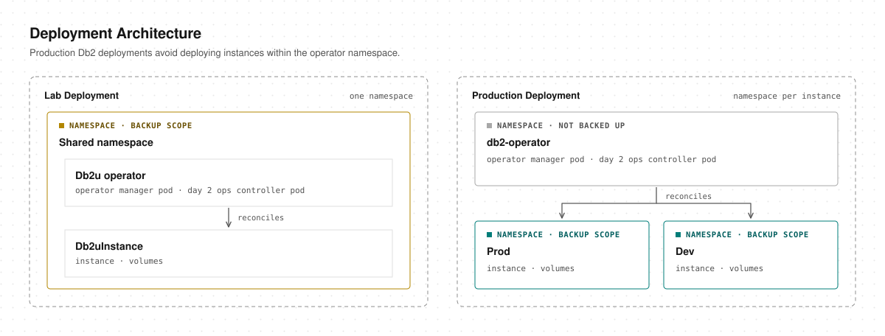
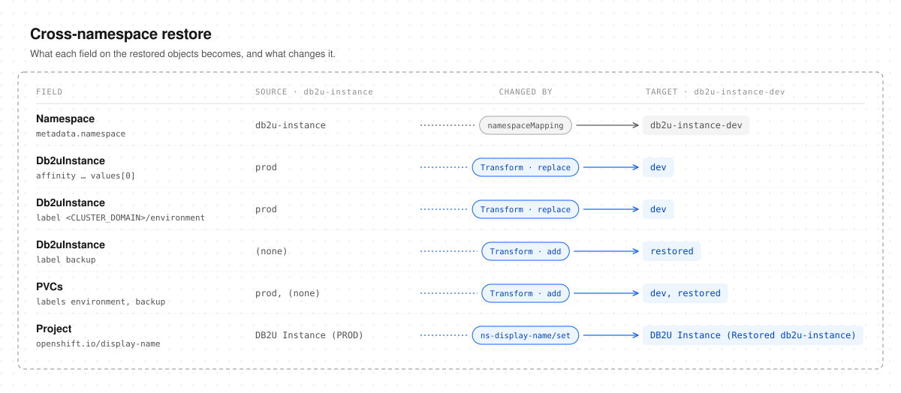
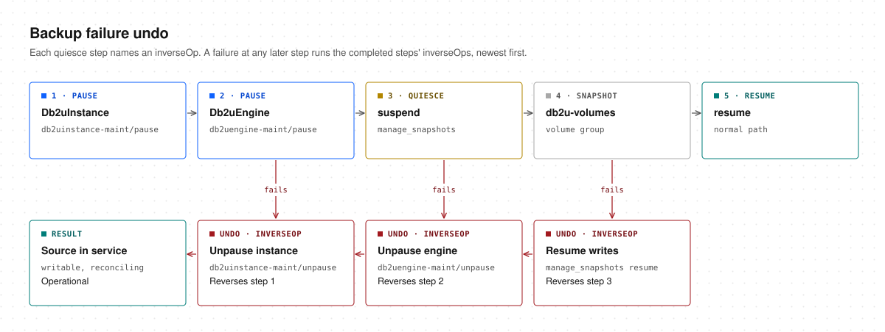

# How it works

Why this recipe exists, how the parent and child recipes run, and what happens on a cross-namespace restore or a failed backup. To deploy it, follow the [deployment guide](deployment-guide.md); to run backups and restores, see [operations](operations.md).

## Why this recipe exists

IBM's sample [`db2u-instance-backup-restore-recipe.yaml`](https://github.com/IBM/storage-fusion/blob/master/backup-restore/recipes/Db2/db2u-instance-backup-restore-recipe.yaml) shows the mechanics correctly for a lab where the operator and the instance share a project, and restores only into the same namespace. Most OpenShift clusters use a different layout: one operator project, one namespace per instance. This recipe is for that layout.

### The layout the sample does not cover

The operator lives in a namespace such as `db2-operator`, deployed and upgraded by GitOps. Each database is a `Db2uInstance` in its own project. That split is how you keep RBAC, tenancy, and upgrades apart, and it changes what a backup should contain: the operator comes back from GitOps, so Fusion only needs the instance.

<picture>
  <source media="(prefers-color-scheme: dark)" srcset="images/how-it-works-layout-namespaces-dark.svg">
  
</picture>

The sample looks for `control-plane=db2u-operator-manager` in the **instance** namespace:

```yaml
namespace: ${GROUP.db2u-volumes.namespace}
```

The manager pod is not there, so these hooks never run:

- `db2u-operator-manager-exec/maintenance-mode-on`
- `db2u-operator-manager-exec/engine-maintenance-mode-on`

Fusion still creates the Backup. The database is never placed in maintenance mode, and the snapshot is not taken. The failure shows in the hook log, not in whether the Backup exists.

The sample also limits restore to the **same** namespace. Promoting prod to dev or QA, rebuilding a project, or recovering onto a spoke all need a different target, rewritten affinity and labels, and a Project display name that belongs to the target.

### What changed from the sample

| Gap in the sample | What this recipe does |
| --- | --- |
| Operator hooks run in the instance namespace | Annotation hooks, run by Fusion itself, patch the `Db2uInstance` and `Db2uEngine`. No hook runs in `db2-operator`, and nothing extra is deployed to run them |
| Operator, subscriptions, and the database are one backup | The Application is the instance namespace only (Fusion discovers it as `db2u-instance`) |
| Exclude-list, then copy everything else | Allow-list: volumes, configmaps, secrets, `Db2uInstance` |
| No undo if a backup step fails after quiesce starts | `inverseOp` on suspend and both pause steps; a later failure undoes each completed step, newest first |
| Same-namespace restore only | Transform, `namespaceMapping`, and a Restore example |
| Target Project shows nothing about the restore | `ns-display-name/set` sets `DB2U Instance (Restored <source namespace>)` on the target namespace |
| One flat recipe | Fusion parent/child dynamic recipe. The assignment names the parent; the child holds every hook and step |
| Nothing marks a restored database | The Transform adds label `backup=restored` to the restored `Db2uInstance` and its PVCs |

## How the recipes run

The PolicyAssignment names only the parent; Fusion finds the child from its labels:

```yaml
dp.isf.ibm.com/parent-recipe: db2u-control
dp.isf.ibm.com/parent-recipe-namespace: ibm-spectrum-fusion-ns
```

The parent has no hooks. It holds the anchor group and two workflows, `backup` and `restore`, each of which calls one child workflow: `instance-backup` or `instance-restore`. The parent declares those two as empty placeholders, and the child supplies them at a higher priority. Every group, hook and step is in the child.

Maintenance mode is an annotation (`db2u.databases.ibm.com/maintenance-pause-reconcile`) on the `Db2uInstance` and `Db2uEngine`. The child sets and clears it with Fusion **annotation hooks**, and sets the target Project's display name the same way. Fusion runs annotation hooks itself, as its `transaction-manager` service account in `ibm-backup-restore`, which can patch Db2u instances, engines and namespaces. The operator reacts to the annotation wherever it runs, and no hook runs in `db2-operator`.

<picture>
  <source media="(prefers-color-scheme: dark)" srcset="images/how-it-works-recipes-architecture-dark.svg">
  
</picture>

Every hook uses `${GROUP.db2u-db2uinstances.namespace}`, from a resource group of that name, so it follows `namespaceMapping` on restore.

<picture>
  <source media="(prefers-color-scheme: dark)" srcset="images/how-it-works-recipes-workflow-dark.svg">
  
</picture>

The backup pauses the instance and engine, copies them, snapshots the volumes and unpauses them, all in one sequence. A failure at any step therefore undoes every completed step ([If a backup step fails](#if-a-backup-step-fails)).

The `Db2uInstance` is copied while it is paused, but Fusion restores it without the maintenance annotation: on Fusion 2.12.2 the restored instance was never paused, from the moment it was created. The operator starts building it straight away, which is what the engine readiness check waits for. The restore still ends by clearing maintenance on the engine and the instance. Removing an annotation that is not there succeeds, so those steps cost nothing, and they cover a restore that does bring the annotation back. IBM's sample clears maintenance straight after restoring the `Db2uInstance` for the same reason.

Groups use `includedResourceTypes`. The sample uses an exclude list and backs up whatever remains, which pulls operator and OLM objects into the backup when they share the namespace. An allow-list leaves a new type out until you add it. Run [`scripts/discover-instance-resources.sh`](../scripts/discover-instance-resources.sh) against a real instance namespace before you widen the list.

`manage_snapshots` runs in container `db2u` on pod `dashmpp-head-0`. That stays an exec hook, in the JSON-array form (`["/bin/bash", "-c", "manage_snapshots --action suspend --retry 3"]`); the multi-line shell form did not run there. A Job hook starts another pod, with another image and identity, and cannot see the binary. The 300 s settle after the restore is an exec hook in the same container.

Fusion reads any dollar-brace text in a recipe as a variable, including in comments. Keep it out of comments, and use `$name` without braces for shell variables in commands.

The `Db2uInstance` must carry `for-backup=true`: the instance pause hook and the readiness check select on it. The example manifest sets it. See [deployment guide §3.4](deployment-guide.md#34-db2uinstance).

Assign `db2u-control` on the PolicyAssignment **before the first backup**. A backup taken with no recipe has no quiesce and no resource order, and a later restore cannot add them. See [I didn't use a recipe on backup](https://community.ibm.com/community/user/blogs/jim-smith/2024/03/13/fusion-recipe-tips-no-backup-recipe).

### Why annotation hooks in the child

Three earlier designs each failed on one point:

1. **Exec hooks in the operator pod.** The maintenance patches ran as `curl` inside the operator manager pod, in `db2-operator`. Backup worked. A cross-namespace restore failed while Fusion was still building the restore recipe, because the parent/child restore loader looks up each **fixed** hook namespace in the Restore's `namespaceMapping`:

   ```text
   recipeloader.py ... in _create_from_spec
   KeyError: 'db2-operator'
   Required parameters missing for restore 'db2-operator'
   ```

2. **Annotation hooks in the parent.** They avoid a fixed namespace, but during a restore the `GROUP` variable did not resolve in hooks defined in the parent, so they could not find the restored instance.
3. **A helper pod.** A small UBI pod with `curl` and its own service account ran the patches from its own namespace. It worked, but every cluster needed the extra pod, a mirrored image and RBAC, and every Restore had to map the helper namespace to itself.

In the **child**, the same `GROUP` variable resolves during restore, as the child's exec and check hooks always did. So the annotation hooks moved there, along with every step that uses them. Nothing extra is deployed, and a Restore maps only the instance namespace.

Annotation hooks run as Fusion's `transaction-manager` service account in `ibm-backup-restore`. On our Fusion 2.12.2 clusters it could already patch Db2u instances, Db2u engines and namespaces, but that may not hold on yours: IBM's sample `restore-pre-req.sh` grants it only `get` and `list` on Db2u resources. [Deployment guide §4.4](deployment-guide.md#44-recipes-and-transform) checks that with `oc auth can-i` on every cluster that backs up **and** every cluster that restores, and shows how to add the rules to Fusion's own ClusterRole where they are missing. Without them the hooks fail with `Forbidden`.

## Restoring into another namespace

A backup taken in namespace A does not apply unchanged in namespace C. Affinity still says prod. Labels still name the source environment. Nothing on the target Project says it holds restored data. Restores failed more often on these than in the backup hooks, including instances that came back and then sat in maintenance shutdown because those references still held the source values.

Four things have to move together:

1. `namespaceMapping` on the Restore: the instance namespace (`db2u-instance` to `db2u-instance-dev`).
2. A Transform whose JSON paths match your `Db2uInstance`. [`templates/ibm-backup-restore/transform/transform.yaml`](../templates/ibm-backup-restore/transform/transform.yaml) rewrites the `Db2uInstance` affinity value and `<CLUSTER_DOMAIN>/environment` label to `${ENV}` (set by `transformMapping` on the Restore), and sets the same label on every restored PVC. Both get `backup=restored`. It is a starting point, not a schema for every cluster.
3. The Db2u operator must watch the target. Add it to the OperatorGroup and `namespace-scope` ConfigMap in `db2-operator` before you restore, or nothing reconciles the restored instance.
4. Worker nodes labelled for the target environment (`<CLUSTER_DOMAIN>/environment=dev`), or the rewritten affinity cannot schedule.

`ns-display-name/set` writes `DB2U Instance (Restored db2u-instance)` over whatever display name the target Project manifest set, as the last step of the restore. The annotation value uses the same `GROUP` variable as the hook's `nameSelector`: in `nameSelector` it resolves to the target namespace, which the hook patches, and in the value it resolves to the source namespace, so the name records where the data came from. That is what Fusion 2.12.2 did. Create the target project before you apply the Restore.

<picture>
  <source media="(prefers-color-scheme: dark)" srcset="images/how-it-works-restore-transform-dark.svg">
  
</picture>

### Credentials and license

Files on disk are not a working instance. Before Db2 12.1.4, OADP restored the database and left credentials and license configuration behind. The pod could start, the restore could look successful, and the instance still could not operate. The usual sign was a trial license, because `db2-lic` had not been preserved.

Db2 **12.1.4** added the Db2 Velero plug-in for that. Add it to the Fusion DataProtectionApplication as `db2-veleroplugin`, as [deployment guide §4.1](deployment-guide.md#41-velero-plugin) shows. Confirm the enterprise license after every cross-namespace test. A Ready pod on a trial license is a failed restore.

On releases older than 12.1.4, the workaround was to put the enterprise license in `db2-lic` before backup so the restored files already contained it. Move to 12.1.4 and the plugin when you can.

## If a backup step fails

Quiesce is what makes the copy consistent, and it is also how a failed backup takes the database out of service. Suspend and both pause steps name an `inverseOp`. If any later step fails, Fusion runs the `inverseOp` of every step already completed, newest first. A failed volume snapshot resumes I/O, then clears engine maintenance, then clears instance maintenance. A failed suspend clears engine and then instance maintenance. A failed engine pause clears instance maintenance.

<picture>
  <source media="(prefers-color-scheme: dark)" srcset="images/how-it-works-failure-failover-dark.svg">
  
</picture>

That path puts the **source** database back into service. It is not a failover to another site. Recovery into another namespace is the Restore in [Restoring into another namespace](#restoring-into-another-namespace). The pattern is IBM's [undo an operation](https://community.ibm.com/community/user/blogs/sandeep-prajapati/2024/04/05/fusion-recipe-tips-how-to-undo-an-operation-in-cas) note.

## Out of scope

- `Db2uCluster`
- Backing up the operator, OLM subscriptions, or cluster-scoped objects
- Job hooks, and parallel children. Parallel execution only helps when one Application covers several instances and every parallel sequence is hooks only. A volume group forces sequential execution.
- Real object-storage keys and the Db2 license. The manifests hold placeholders that `scripts/render.sh` fills from your own `.env`

## Further reading

- [IBM Fusion Db2 recipes](https://github.com/IBM/storage-fusion/tree/master/backup-restore/recipes/Db2)
- [Dynamic parent/child recipes](https://community.ibm.com/community/user/blogs/ashish-gupta/2025/06/04/fusion-dynamic-recipe)
- [Undo with `inverseOp`](https://community.ibm.com/community/user/blogs/sandeep-prajapati/2024/04/05/fusion-recipe-tips-how-to-undo-an-operation-in-cas)
- [Make a recipe generic](https://community.ibm.com/community/user/blogs/ashish-gupta/2024/03/25/fusion-recipe-tips-keeping-database-credentials-a)
- [Check hook conditions](https://community.ibm.com/community/user/blogs/sandeep-prajapati/2025/06/12/how-to-write-fusion-recipe-check-hook-condition-st)
- [Label and annotation hooks](https://community.ibm.com/community/user/blogs/sandeep-prajapati/2025/06/12/using-fusion-label-and-annotation-hooks)
- [Resource discovery](https://community.ibm.com/community/user/blogs/sandeep-prajapati/2026/01/11/making-kubernetes-or-openshift-backup-and-restore)
