# Operations — backup and restore

Step 5 of [deployment-guide.md](deployment-guide.md). Steps 1–4 must be done and every line of [Ready to back up?](deployment-guide.md#ready-to-back-up) must pass. The commands use the shell names set in [Render the manifests](deployment-guide.md#render-the-manifests) (`FUSION_NS`, `SOURCE_NS`, `TARGET_NS`, `INSTANCE`, `ENV_KEY` and `ENV_LABEL`, from `build/env.sh`).

| File | Role |
| --- | --- |
| [`templates/ibm-backup-restore/operations/backup.yaml`](../templates/ibm-backup-restore/operations/backup.yaml) | On-demand Backup of Application `db2u-instance` with `db2u-instance-backup-policy` |
| [`templates/ibm-backup-restore/operations/restore.yaml`](../templates/ibm-backup-restore/operations/restore.yaml) | Restore of a `db2u-instance` backup into `db2u-instance-dev`, with the parent recipe and the transform |

The policy also runs a scheduled backup daily at 04:00. The PolicyAssignment keeps `runNow: false`, so applying it does not start one.

## Back up

### From the Fusion UI

1. **Backed up applications**, filter on `db2u-instance`. The recipe column shows `db2u-control`.

   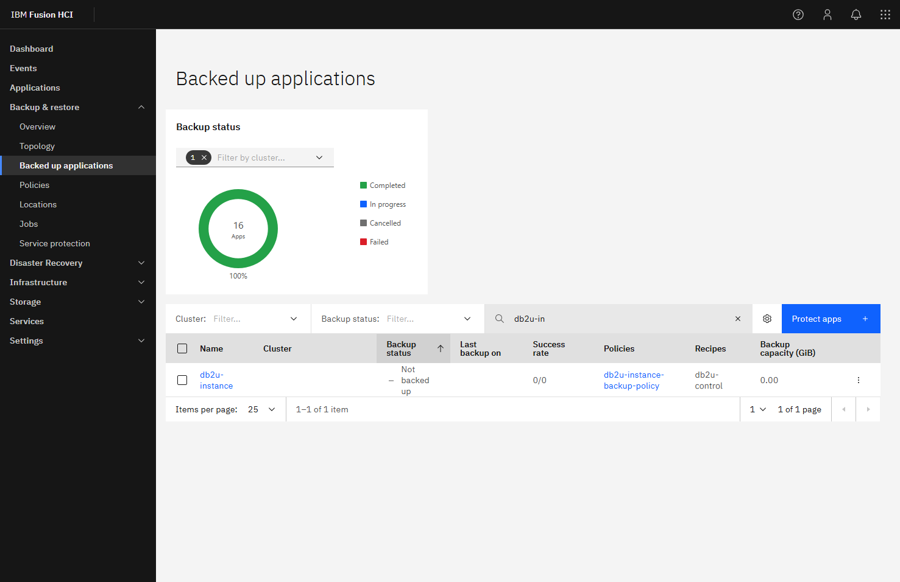

2. Open `db2u-instance`, **Backups** tab, then **Actions → Back up now**.

   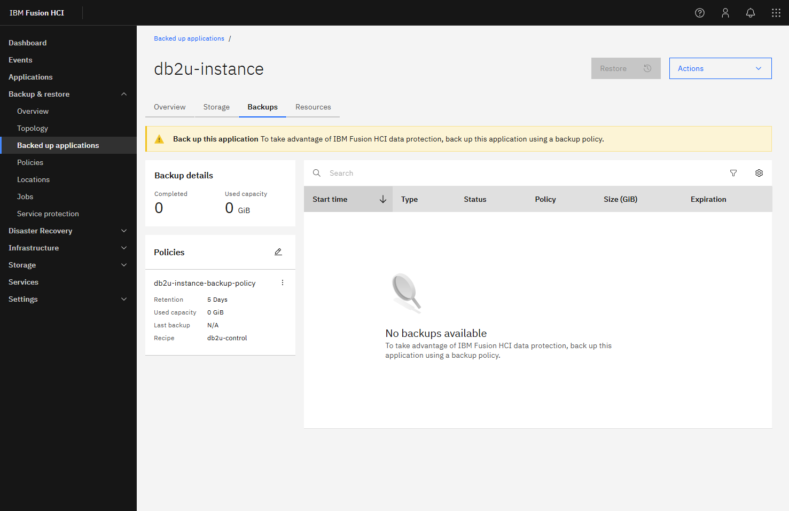

3. Confirm the policy and **Back up**.

   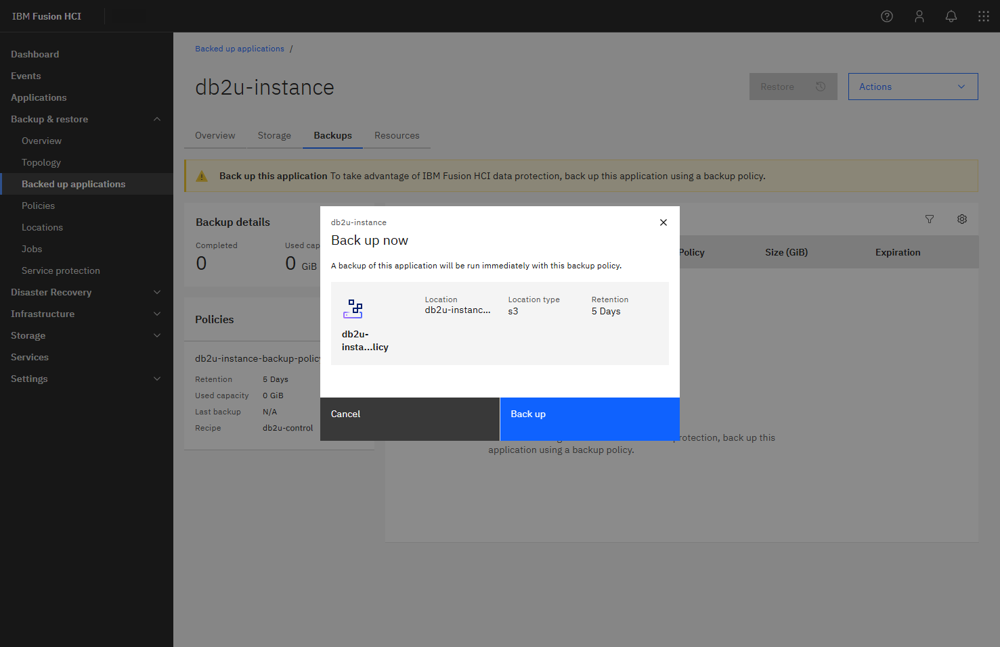

4. The job moves through pending, checking inventory, and snapshot. The recipe pauses the instance and engine first, suspends Db2 writes for the volume snapshot, resumes them, and then unpauses the engine and the instance.

5. Completed. Under **Jobs**, the backup job lists each step of `db2u-workflow`'s backup sequence:

   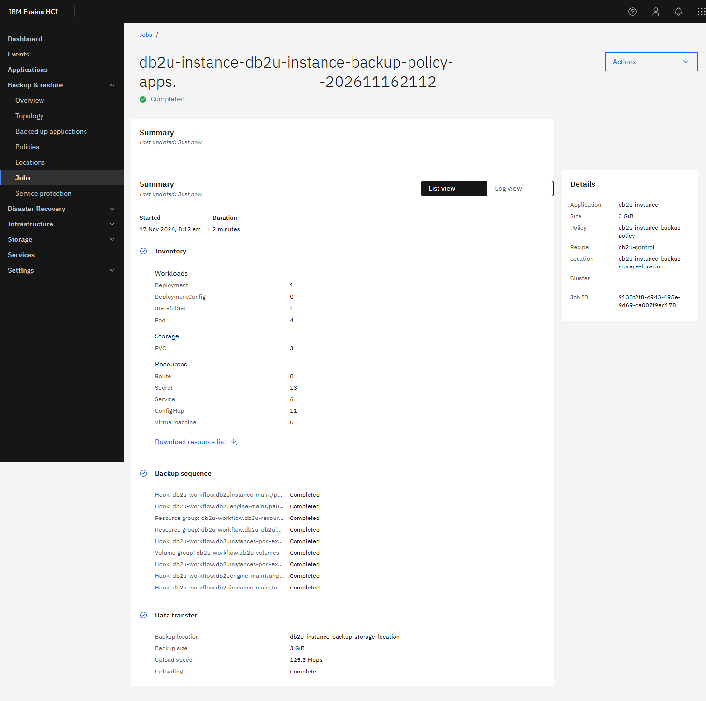

### From the CLI

In the rendered copy, `build/ibm-backup-restore/operations/backup.yaml`, set a unique `metadata.name` for each run, then apply it. The namespaces and application are already filled in from `.env`. Running `./scripts/render.sh` again resets this file, so set the name after rendering.

Dry run first. It checks the name and fields and starts nothing:

```bash
oc apply --dry-run=server -f build/ibm-backup-restore/operations/backup.yaml
```

Expect `backup.data-protection.isf.ibm.com/<name> created (server dry run)`. `configured` or `unchanged` means a Backup with that name already exists: set a new name. Then apply and watch:

```bash
oc apply -f build/ibm-backup-restore/operations/backup.yaml
oc get backups.data-protection.isf.ibm.com -n "$FUSION_NS" -w
```

### Check

List the backups with their application and phase. The newest `db2u-instance` row should show a completed phase:

```bash
oc get backups.data-protection.isf.ibm.com -n "$FUSION_NS" --sort-by=.metadata.creationTimestamp \
  -o custom-columns=NAME:.metadata.name,APPLICATION:.spec.application,PHASE:.status.phase
```

Then confirm the backup released the database. `PAUSED` must be `<none>` on every row; `true` means maintenance mode is still set:

```bash
oc get db2uinstances.db2u.databases.ibm.com,db2uengines.db2u.databases.ibm.com -n "$SOURCE_NS" \
  -o custom-columns='KIND:.kind,NAME:.metadata.name,PAUSED:.metadata.annotations.db2u\.databases\.ibm\.com/maintenance-pause-reconcile'
```

## Restore into another namespace

Before every restore into a new target:

- The target project exists (`build/db2u-instance/restore-target-project.yaml`).
- The target is in the Db2 OperatorGroup and `namespace-scope` ConfigMap ([deployment guide §3.2](deployment-guide.md#32-let-the-operator-watch-the-source-and-every-restore-target)).
- Nodes carry `<CLUSTER_DOMAIN>/environment=<ENV_LABEL>` ([§3.3](deployment-guide.md#33-label-worker-nodes)).
- The hook permission check passes on the restoring cluster ([§4.4](deployment-guide.md#44-recipes-and-transform)).

1. Copy the backup name from the completed backup job. It has the form `<application>-<policy>-<cluster>-<yyyymmddhhmm>`.

   

2. Edit the rendered copy, `build/ibm-backup-restore/operations/restore.yaml`. The namespaces and `ENV` come from `.env`; set the run's name and backup. In the example values:

   ```yaml
   metadata:
     name: custom-restore-db2u-instance-<yyyymmdd-hhmm>   # unique per run
   spec:
     backup: <backup name from step 1>
     namespaceMapping:
       db2u-instance: db2u-instance-dev                  # SOURCE_NS to TARGET_NS
     recipe:
       name: db2u-control
       namespace: ibm-spectrum-fusion-ns
     transform: db2u-instance-restore-transform
     transformMapping:
       ENV: dev                                          # ENV_LABEL: affinity value and environment label
   ```

3. Dry run first. It checks the name and fields and starts nothing:

   ```bash
   oc apply --dry-run=server -f build/ibm-backup-restore/operations/restore.yaml
   ```

   Expect `restore.data-protection.isf.ibm.com/<name> created (server dry run)`. `configured` or `unchanged` means a Restore with that name already exists: set a new name.

4. Apply and watch:

   ```bash
   oc apply -f build/ibm-backup-restore/operations/restore.yaml
   oc get restores.data-protection.isf.ibm.com -n "$FUSION_NS" -w
   oc get db2uinstances.db2u.databases.ibm.com,pods,pvc -n "$TARGET_NS"
   ```

   The restore brings back the volumes, resources and the `Db2uInstance`, waits for the engine to be Ready, runs `manage_snapshots --action restore`, waits for the instance to be Ready, waits 300 s, clears maintenance on the engine and the instance, and sets the target display name. The instance comes back unpaused, so clearing maintenance normally changes nothing; it is there in case a restore ever brings the annotation back.

   In the Fusion UI the restore appears on the application's **Backups** tab, pending at first:

   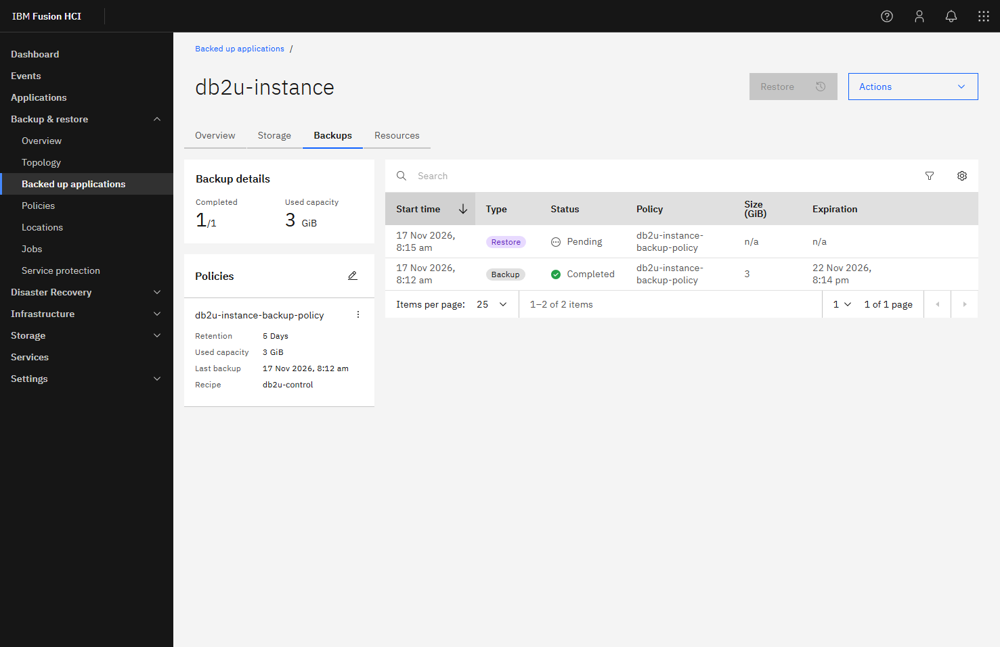

   The restore job lists each step of `db2u-workflow`'s restore sequence, ending with the display name:

   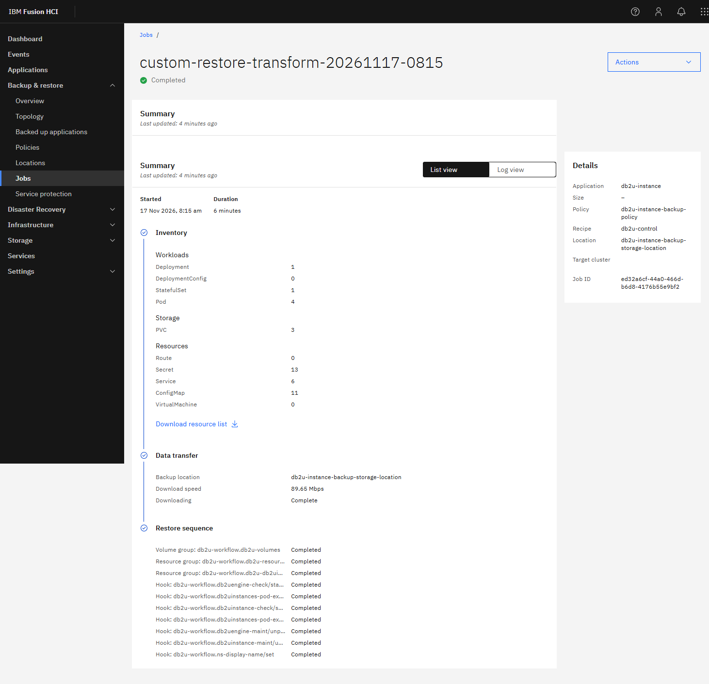

   When it finishes, the backup and the restore both show Completed:

   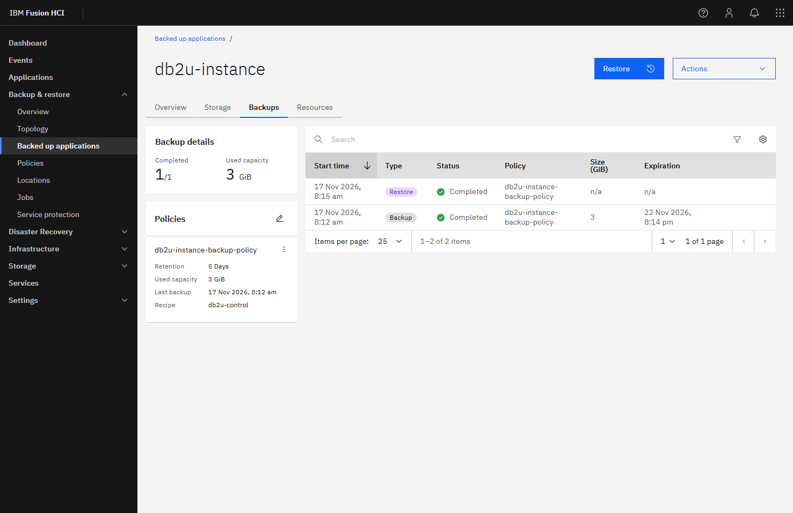

5. Check the target:

   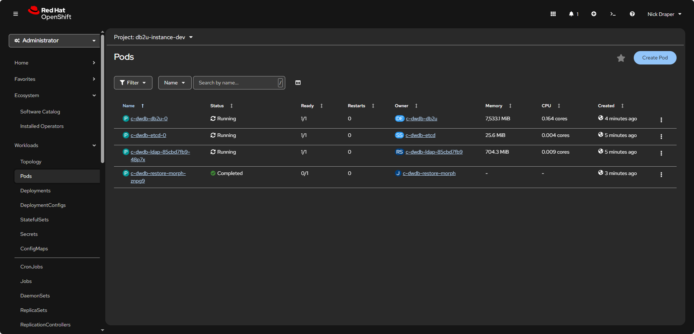
   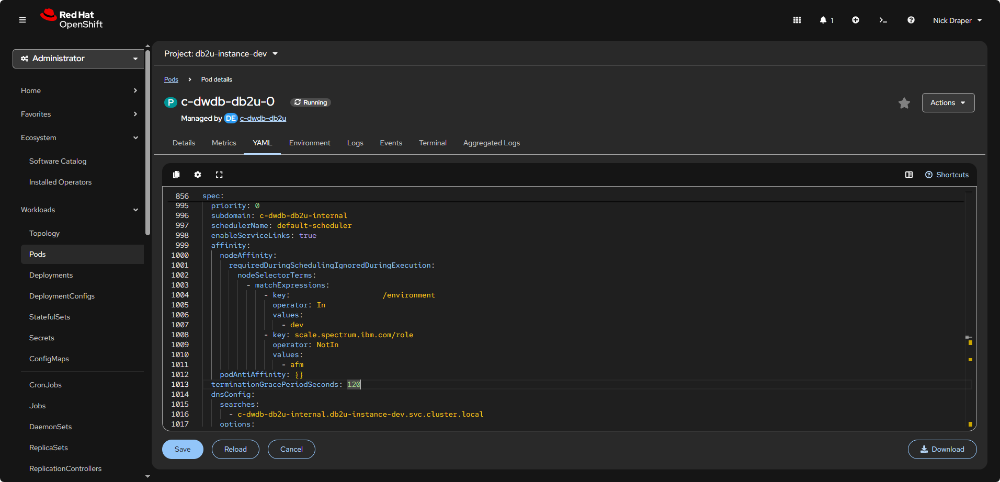
   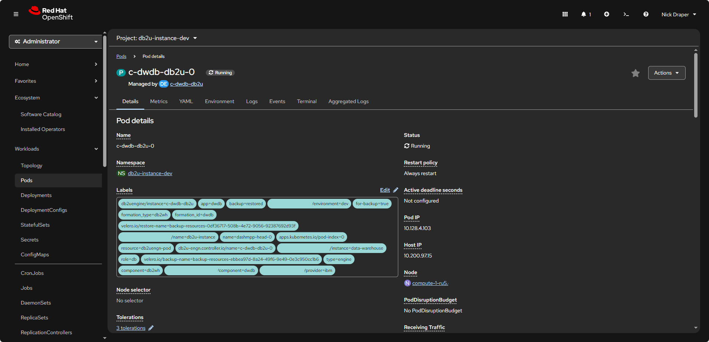
   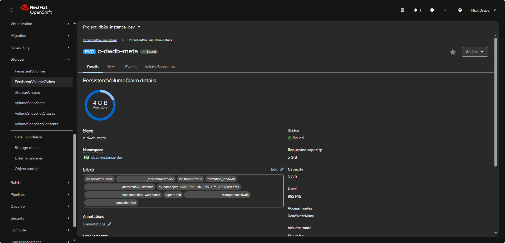

   ```bash
   oc get project "$TARGET_NS" -o jsonpath='{.metadata.annotations.openshift\.io/display-name}'; echo
   oc get db2uinstances.db2u.databases.ibm.com "$INSTANCE" -n "$TARGET_NS" -L backup -L "$ENV_KEY"
   oc get pvc -n "$TARGET_NS" -L backup -L "$ENV_KEY"
   oc get db2uinstances.db2u.databases.ibm.com,db2uengines.db2u.databases.ibm.com -n "$TARGET_NS" \
     -o custom-columns='KIND:.kind,NAME:.metadata.name,PAUSED:.metadata.annotations.db2u\.databases\.ibm\.com/maintenance-pause-reconcile'
   oc get db2uinstances.db2u.databases.ibm.com "$INSTANCE" -n "$TARGET_NS" -o jsonpath='{.status.state}'; echo
   oc get db2uinstances.db2u.databases.ibm.com "$INSTANCE" -n "$SOURCE_NS" -o jsonpath='{.status.state}'; echo
   ```

   In order, expect: `DB2U Instance (Restored db2u-instance)`, naming the source namespace; `restored` and your `ENV_LABEL` on the instance; the same two labels on every PVC; `<none>` under `PAUSED`; `Ready` for the restored instance; and `Ready` for the source, which the restore must not touch.

6. Confirm the **enterprise** license on the restored instance yourself. A Ready instance on a trial license means the Velero plugin did not run.

Measure how long the restore takes and set Restore timeouts above it. A timed-out restore has deleted the target namespace in practice; see [Slow restores and timeouts](#slow-restores-and-timeouts).

## Slow restores and timeouts

Db2 recovery can take a long time. Crash recovery, log replay, and rollback are heavy on CPU, memory, and disk. An undersized pod, a slow storage class, or an eviction can stretch a restore for hours. Fusion may report the recipe step complete while the database is still recovering, or the Restore may hit its timeout.

The recipe allows `manage_snapshots --action restore` 10 minutes. It only brings the database out of write suspend; with snapshots taken in write suspend it normally finishes in a minute or two. If yours runs longer, raise that op's `timeout`, and the hook's, in `child-recipe.yaml`.

Size the target for recovery, not for steady state. Watch pod CPU, memory, and volume latency while `manage_snapshots restore` and the readiness checks run. Set the Restore timeout from a measured run in your cluster. Cancel a stuck restore before the timeout fires.

We also saw a Restore timeout followed by deletion of the **target** namespace, rather than a partial apply left in place. Treat that as a data-loss risk:

- Measure restore time before you depend on it.
- Set the timeout above that measurement.
- If a target namespace disappears, read the Restore status and the audit log before you assume a person deleted the project.
